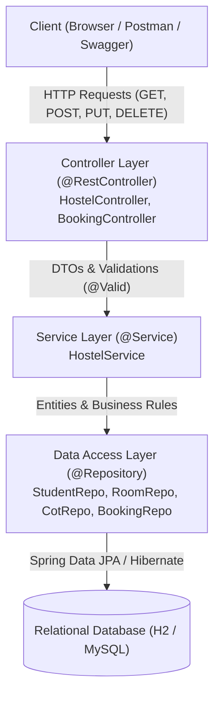
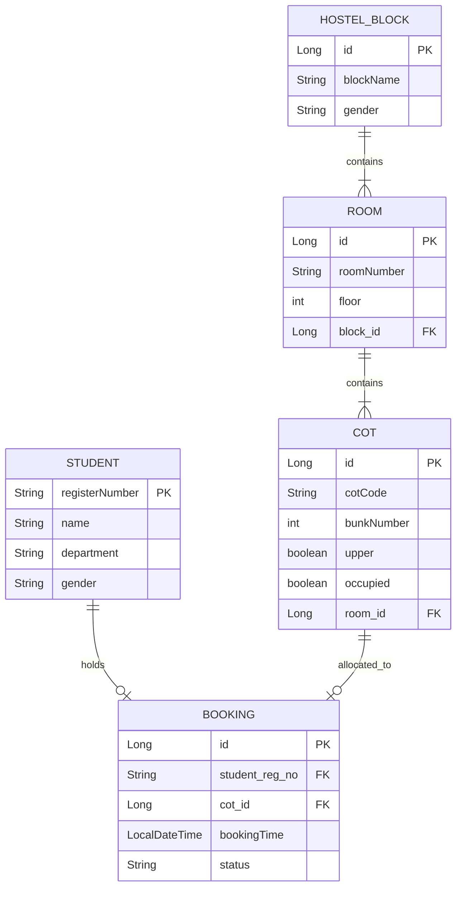

# AbodeX — Smart Hostel Room Allocation System
*A cot-level hostel room allocation web application engineered with Spring Boot, Spring Data JPA, and RESTful APIs.*

[](https://openjdk.org/)
[](https://spring.io/projects/spring-boot)
[](https://spring.io/projects/spring-data-jpa)
[](http://localhost:8080/swagger-ui/index.html)
[](http://localhost:8080/h2-console)

---

## 1. Project Overview & Problem Statement
In universities such as Anna University, hostel allocation is traditionally conducted at a coarse room-level or through paper/manual queues. This creates lack of visibility over cot ergonomics (students have distinct preferences for Upper vs. Lower bunks) and roommate transparency.

**AbodeX** resolves this by providing a **cot-level visual room allocation system**:
- **Campus Scale**: 13 Hostels for Boys and 8 Hostels for Girls.
- **Block Layout**: 4 Floors per block (Ground, First, Second, Third).
- **Floor Density**: 40 Rooms per floor (Rooms `001`–`040`, `101`–`140`, `201`–`240`, `301`–`340`) = **160 total rooms**.
- **Room Capacity**: 4 occupants per room distributed across 2 bunk beds:
  - `Bunk 1 · Upper` & `Bunk 1 · Lower`
  - `Bunk 2 · Upper` & `Bunk 2 · Lower`
  - Total **640 distinct cot positions** per hostel block.
- **Enforced Rules**:
  - **Single-Cot Policy**: A student (identified by their unique University Register Number) can hold only **one** cot across the university at any given time.
  - **Concurrency & Conflict Prevention**: Double booking of the same cot by two simultaneous requests is prevented with database constraints and transactional validation.

---

## 2. Technology Stack
- **Backend Framework**: Spring Boot 3.3.4
- **Language**: Java 17+ (Compatible with Java 21 & 25)
- **Data Persistence**: Spring Data JPA & Hibernate ORM
- **Database**: H2 In-Memory & Persistent relational engine (Console enabled)
- **Validation**: Jakarta Bean Validation (`jakarta.validation-api`)
- **API Documentation**: Springdoc OpenAPI 3.0 / Swagger UI
- **Testing**: JUnit 5, Mockito, Spring Boot Test, MockMvc
- **Frontend (Bonus)**: Responsive, dark-mode single-page client serving real-time status and interactive cot selection.

---

## 3. Architecture & Design Documentation

### Layered Architecture Flow


### Entity Relationship (ER) Diagram


---

## 4. REST API Documentation (CRUD Operations)

| Operation | HTTP Method | Endpoint URL | Request Body | Response Code & Output | Description |
| :--- | :--- | :--- | :--- | :--- | :--- |
| **READ** | `GET` | `/api/blocks` | None | `200 OK` (Array of blocks) | Returns all 21 Anna University blocks |
| **READ** | `GET` | `/api/blocks/{blockName}/floors/{floor}` | None | `200 OK` (40 RoomCardDtos) | Returns 40 rooms with occupancy count |
| **READ** | `GET` | `/api/blocks/{blockName}/rooms/{roomNumber}`| None | `200 OK` (RoomCardDto + 4 Cots) | Returns cot occupancies & occupants |
| **CREATE** | `POST` | `/api/bookings` | `BookingRequestDto` (JSON) | `201 Created` (`BookingResponseDto`) | Allots an available cot to a student |
| **READ** | `GET` | `/api/bookings/{regNo}` | None | `200 OK` (`BookingResponseDto`) | Fetches active allotment for a student |
| **UPDATE** | `PUT` | `/api/bookings/{regNo}` | `BookingRequestDto` (JSON) | `200 OK` (`BookingResponseDto`) | Switches room/cot for student |
| **DELETE** | `DELETE` | `/api/bookings/{regNo}` | None | `204 No Content` | Vacates cot & cancels booking |

---

## 5. Sample Payloads

### 1. Create Cot Booking (`POST /api/bookings`)
**Request Header**: `Content-Type: application/json`
```json
{
  "registerNumber": "2023103001",
  "name": "Arun Kumar",
  "department": "Computer Science and Engineering",
  "gender": "Boys",
  "blockName": "Kurinji Block (Boys)",
  "roomNumber": "014",
  "cotCode": "B1_U"
}
```

**Response (`201 Created`)**:
```json
{
  "bookingId": 1,
  "registerNumber": "2023103001",
  "studentName": "Arun Kumar",
  "department": "Computer Science and Engineering",
  "blockName": "Kurinji Block (Boys)",
  "roomNumber": "014",
  "floor": 0,
  "cotCode": "B1_U",
  "cotLabel": "Bunk 1 · Upper",
  "bookingTime": "2026-10-20T23:30:00",
  "status": "CONFIRMED"
}
```

### 2. Error Response on Duplicate Booking Attempt (`409 Conflict`)
```json
{
  "timestamp": "2026-10-20T23:31:00",
  "status": 409,
  "error": "Booking Conflict",
  "message": "Student with Register No 2023103001 already has an active cot booking. Anna University allows only 1 cot per student.",
  "path": "/api/bookings"
}
```

---

## 6. How to Build and Run

### Prerequisites
- JDK 17, 21, or 25 installed.
- Maven 3.8+ (A convenience `run.bat` is bundled that detects IntelliJ's bundled JDK & Maven automatically).

### Quick Launch (Windows)
Double-click [`run.bat`](file:///C:/Users/krish/.gemini/antigravity/scratch/AbodeX-SpringBoot/run.bat) in this folder.

### Command Line
```powershell
# 1. Navigate to directory
cd C:\Users\krish\.gemini\antigravity\scratch\AbodeX-SpringBoot

# 2. Compile and run unit tests
mvn clean test

# 3. Start the Spring Boot Application
mvn spring-boot:run
```

Once started:
- 🌐 **Web Application**: [`http://localhost:8080`](http://localhost:8080)
- 📄 **Interactive Swagger API Docs**: [`http://localhost:8080/swagger-ui/index.html`](http://localhost:8080/swagger-ui/index.html)
- 🗄️ **H2 Database Console**: [`http://localhost:8080/h2-console`](http://localhost:8080/h2-console)
  - JDBC URL: `jdbc:h2:mem:abodexdb`
  - User: `sa`
  - Password: `password`

---

## 7. Automated Testing
Run the test suite covering both Unit and Integration tests:
```powershell
mvn test
```
- `BookingServiceTest`: Verifies business rules (successful booking, 1-cot rule, duplicate rejection, cancellation).
- `BookingControllerTest`: Verifies MockMvc HTTP responses, status codes (201, 200, 204, 400), and validation constraints.
