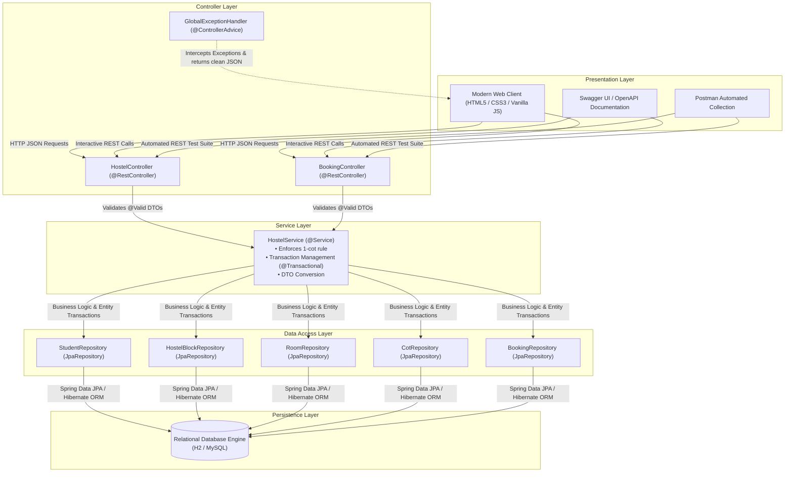
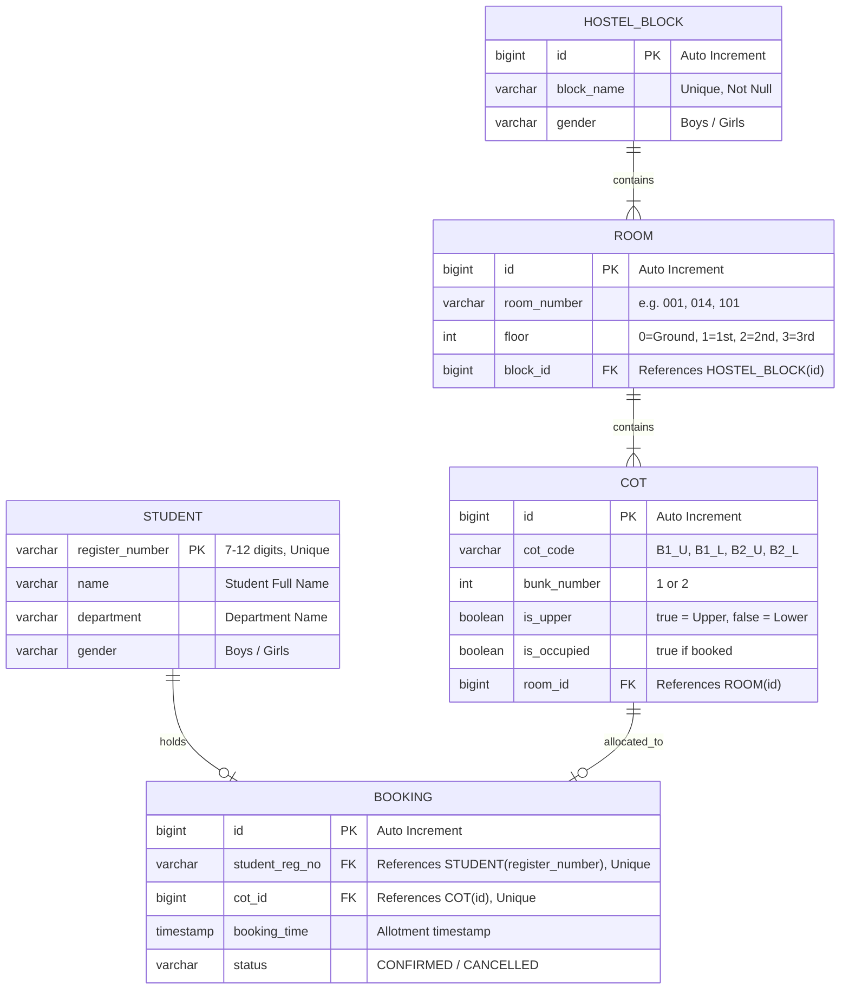
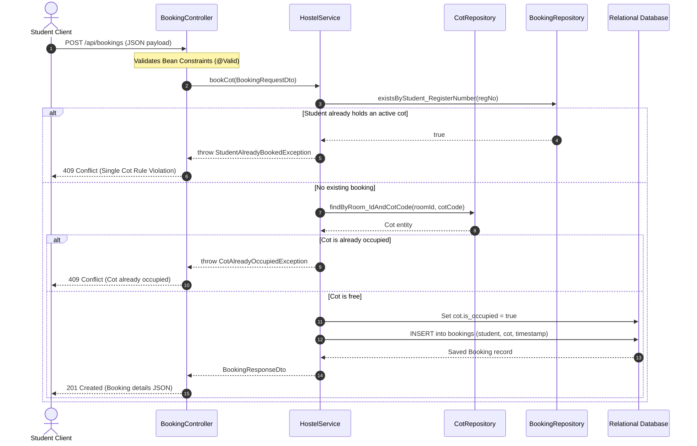

# AbodeX — Software Architecture & Design Documentation
*Design specification adhering to Criterion 3 & Documentation Breakdown Item 3 (0.5 Marks).*

---

## 1. Problem Statement
At large residential institutions like Anna University (featuring 13 Boys Hostels and 8 Girls Hostels), traditional room allocation systems operate at a generic "room" level. Students are forced to accept room numbers blindly without knowing:
1. Which specific cot position (Upper vs. Lower bunk) is available.
2. Who their future roommates are.
3. Live occupancy levels across floors in a single glance.

**AbodeX** solves this by engineering a **visual, cot-level room allocation architecture**:
- Manages 160 rooms per hostel block (40 rooms per floor across Ground, First, Second, and Third floors).
- Distributes each room into two bunk beds: `Bunk 1 Upper`, `Bunk 1 Lower`, `Bunk 2 Upper`, `Bunk 2 Lower` (640 distinct cot positions per block).
- Enforces strict institutional constraints (Single-Cot rule, atomic reservations, role segregation).

---

## 2. System Architecture & Layered Design

AbodeX adheres strictly to the **Separation of Concerns (SoC)** principle using a standard 4-layer Spring Boot enterprise pattern:

### Layer Responsibilities

1. **Presentation Layer (`src/main/resources/static`)**:
   - Renders the interactive dark dashboard matching university guidelines.
   - Communicates asynchronously via `fetch()` with REST endpoints.
2. **Controller Layer (`com.abodex.controller`)**:
   - Exposes RESTful APIs with sensible HTTP status codes (`200`, `201`, `204`, `400`, `404`, `409`).
   - Validates input payloads using `@Valid` and Jakarta Bean Validation.
3. **Service Layer (`com.abodex.service`)**:
   - Contains all core business logic and transaction boundaries (`@Transactional`).
   - Enforces the Single-Cot rule and checks cot vacancy before booking.
4. **Data Access Layer (`com.abodex.repository`)**:
   - Extends Spring Data `JpaRepository<T, ID>` providing type-safe CRUD operations, custom query methods, and derived queries.
5. **Entity Layer (`com.abodex.model`)**:
   - Encapsulates relational domain entities mapped with JPA annotations (`@Entity`, `@Table`, `@Id`, `@OneToMany`, `@ManyToOne`, `@OneToOne`).

---

## 3. Entity-Relationship (ER) Model

---

## 4. Database Schema Specification

### 4.1 Table: `hostel_blocks`
| Column | Type | Constraints | Description |
| :--- | :--- | :--- | :--- |
| `id` | `BIGINT` | `PRIMARY KEY, AUTO_INCREMENT` | Unique block identifier |
| `block_name` | `VARCHAR(100)` | `NOT NULL, UNIQUE` | Name of the block (e.g. "Kurinji Block (Boys)") |
| `gender` | `VARCHAR(20)` | `NOT NULL` | "Boys" or "Girls" |

### 4.2 Table: `rooms`
| Column | Type | Constraints | Description |
| :--- | :--- | :--- | :--- |
| `id` | `BIGINT` | `PRIMARY KEY, AUTO_INCREMENT` | Unique room record ID |
| `room_number` | `VARCHAR(10)` | `NOT NULL` | "001" to "040", "101" to "140", etc. |
| `floor` | `INT` | `NOT NULL` | Floor index: 0, 1, 2, 3 |
| `block_id` | `BIGINT` | `NOT NULL, FOREIGN KEY` | FK referencing `hostel_blocks(id)` |

### 4.3 Table: `cots`
| Column | Type | Constraints | Description |
| :--- | :--- | :--- | :--- |
| `id` | `BIGINT` | `PRIMARY KEY, AUTO_INCREMENT` | Unique cot record ID |
| `cot_code` | `VARCHAR(20)` | `NOT NULL` | "B1_U", "B1_L", "B2_U", "B2_L" |
| `bunk_number` | `INT` | `NOT NULL` | Bunk index (1 or 2) |
| `is_upper` | `BOOLEAN` | `NOT NULL` | `true` = Upper cot, `false` = Lower cot |
| `is_occupied`| `BOOLEAN` | `NOT NULL` | `true` if booked, `false` if vacant |
| `room_id` | `BIGINT` | `NOT NULL, FOREIGN KEY` | FK referencing `rooms(id)` |

### 4.4 Table: `students`
| Column | Type | Constraints | Description |
| :--- | :--- | :--- | :--- |
| `register_number` | `VARCHAR(20)` | `PRIMARY KEY` | Anna University Registration Number |
| `name` | `VARCHAR(100)` | `NOT NULL` | Full Name |
| `department` | `VARCHAR(100)` | `NOT NULL` | Department (CSE, IT, ECE, MECH, etc.) |
| `gender` | `VARCHAR(20)` | `NULLABLE` | Student Gender |

### 4.5 Table: `bookings`
| Column | Type | Constraints | Description |
| :--- | :--- | :--- | :--- |
| `id` | `BIGINT` | `PRIMARY KEY, AUTO_INCREMENT` | Unique booking ID |
| `student_reg_no` | `VARCHAR(20)` | `NOT NULL, UNIQUE, FOREIGN KEY` | Student holding this booking (Enforces 1-cot rule) |
| `cot_id` | `BIGINT` | `NOT NULL, UNIQUE, FOREIGN KEY` | Cot assigned (Prevents double booking) |
| `booking_time` | `TIMESTAMP` | `NOT NULL` | Instant of booking confirmation |
| `status` | `VARCHAR(30)` | `NOT NULL` | "CONFIRMED" or "CANCELLED" |

---

## 5. Booking Workflow (Sequence Flow)

